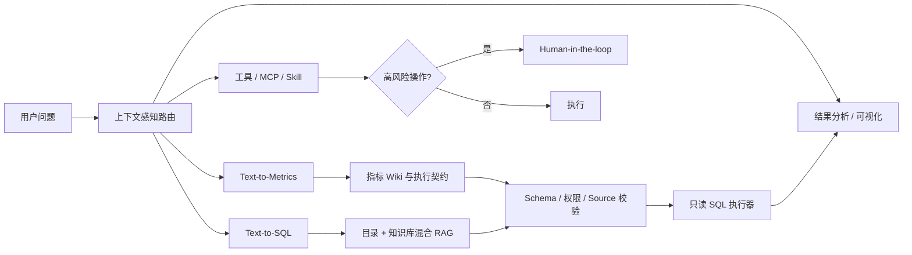

# Metric Pilot

治理优先的 Data Agent 与轻量数据服务平台，面向数据目录、指标口径管理、自然语言取数和结果分析。项目以 LangGraph 编排对话与数据任务，支持 PostgreSQL/SQLite、混合 RAG、Text-to-Metrics/Text-to-SQL 双路由、统一指标 API、审批驱动的数据生产和可视化结果。

> A governance-first Data Agent: resolve the business definition, validate permissions and schema, then generate and execute read-only SQL.


## 项目亮点

- **指标优先**：先绑定 `metric_id + version` 和已认证执行契约，再生成 SQL；缺失、歧义、无权限或失效口径不会静默降级。
- **安全查询**：SQLGlot 解析、只读白名单、字段权限、超时与行数限制，并要求 SQL 表唯一映射到同一已授权数据源。
- **混合 RAG**：Milvus/BGE 稠密召回 + 中文 BM25 + RRF + reranker，支持目录元数据、知识文档、关系边和边界安全的精确标识符。
- **可扩展 Agent**：统一管理工具、MCP Server、Skills、知识库和模型供应商；高风险 SQL 写入及 ETL 支持人工审批。
- **完整产品界面**：会话、数据目录、指标中心、血缘、数据源、智能体与模型管理、附件和图表可视化。
- **可验证**：提供隔离测试、PostgreSQL 黄金查询、真实模型正确率、稳定性和 RAG 召回率评测脚本。

## 已验证基线

以下结果使用合成 PostgreSQL 数仓；模型验收关闭 Agent 与工具缓存并连续运行三轮：

| 验收面 | 结果 |
| --- | ---: |
| 后端隔离测试 | 443 passed |
| 前端测试 | 12/12 passed |
| PostgreSQL 确定性黄金查询 | 三轮累计 90/90 |
| 完整 LangGraph + 模型业务题 | 三轮累计 30/30 |
| 同义改写、追问、歧义、权限稳定性 | 三轮累计 36/36 |
| RAG Recall@5 / Recall@12 | 97.44% / 100% |
| RAG P50 / P95 | 41.71 ms / 71.88 ms |

详细测量口径见 [`docs/first-token-optimization-notes.md`](docs/first-token-optimization-notes.md)。固定评测集结果不等同于生产 SLA，生产环境仍应使用自身数据和问题集验收。

## 启动

首次恢复代码时先创建 Python 3.12 虚拟环境并安装前端依赖：

```powershell
py -3.12 -m venv .venv
npm ci
```

Windows 上可用 `requirements.windows.lock.txt` 安装本次测试的精确版本；其他平台使用 `requirements.txt`。`.env`、`.data` 中的账号、凭据、会话和数据库不属于 Git 代码快照，恢复部署需单独准备，切勿用 Git 回滚替代数据备份。

```powershell
.\.venv\Scripts\python.exe -m pip install -r requirements.txt
npm run api
# 新开一个终端
npm run dev
```

打开 `http://localhost:5174`；FastAPI 默认运行在 `http://127.0.0.1:18001`。

新环境使用 `.env` 时可用 `.venv\\Scripts\\python.exe -m uvicorn backend.main:app --host 127.0.0.1 --port 18001 --env-file .env` 启动后端。只有全新演示环境才运行 `scripts/seed_demo_warehouse.py`：它会重建 `.data/demo.db` 并重写演示元数据，已有数据时不要执行。`APP_ENCRYPTION_KEY` 必须是有效 Fernet 密钥，已有部署不得随意更换。

独立回归测试：`.venv\\Scripts\\python.exe scripts/test_backend_isolated.py`（临时库、离线向量配置，不依赖个人 `.env`）。

## 接入 PostgreSQL 数据源

本机开发先在 `.env` 配置 `DATA_AGENT_SSH_SERVER` 和 `DATA_AGENT_SSH_KEY_PATH`，再运行 `npm run start:local`。它会按需启动前端、后端和 SSH 隧道守护进程；隧道断线后会指数退避并自动重连。`npm run health` 会同时检查 PostgreSQL、Milvus、embedding 和 reranker。也可在已设置这两个环境变量的终端单独运行 `scripts/start-milvus-tunnel.ps1`。该脚本会把服务器上的测试 PostgreSQL 映射到本机 `127.0.0.1:15433`。生产部署不依赖该隧道，应填写 PostgreSQL 的内网/VPC 地址。

使用平台管理员账号登录后，进入“系统管理 → 数据源管理 → 添加数据源”，依次填写：

- 类型：`PostgreSQL`
- 地址：本机开发填写 `127.0.0.1:15433`，生产环境填写数据库内网地址及端口
- 数据库：例如 `data_agent_warehouse`
- 只读用户名与密码：使用专门的查询账号，不使用数据库管理员账号

保存后先点击“测试连接”，确认返回只读连接成功；再点击“采集表结构”。连接器会采集 Schema、表、字段、数据类型、表/字段注释、主键和外键关系，并保存为可审核的目录草稿。密码由后端使用 Fernet 加密，只返回“已配置”状态，不会回传浏览器或写入 Git。

采集器会解析数据源注释中的 `业务域=...;分层=...;粒度=...`、字段业务别名和敏感级别。管理员可在“数据目录 → 数据资产”按状态和数据源筛选，逐表核对后使用批量发布；服务端会校验每张表的版本和完整度，只发布通过项，并在整批结束后统一刷新一次 RAG 索引。

`npm run verify:postgres` 会对当前启用的 PostgreSQL 数据源运行 30 条固定黄金用例，覆盖指标、时间、Join、去重、数仓分层一致性、权限、停用数据源和结果行数限制，报告写入 `.data/evals/postgresql-latest.json`。`npm run evaluate:postgres` 还会选取 10 条代表性问题走完整 LangGraph 与当前配置模型，记录答案正确率、首 token 和总耗时。

## 启用 DeepSeek 对话 Agent

项目根目录的 `.env` 仅保存在本机，且已被 Git 忽略。首次配置时可复制 `.env.example` 并填入自己的 Key：

```dotenv
DEEPSEEK_API_KEY=你的密钥
DEEPSEEK_BASE_URL=https://api.deepseek.com
DEEPSEEK_MODEL=deepseek-v4-flash
```

也可以在“智能体管理 → 模型供应商”中配置 OpenAI Compatible、Anthropic Messages、Ollama 或 vLLM。LangGraph 会根据对话决定普通回答、目录问答、数据查询、结果分析或受控 ETL；各节点使用智能体管理中绑定的模型与权限。

## 知识库向量检索（Milvus）

知识库的文档、权限和切块元数据保存于本地 SQLite；BGE 切块向量写入独立的 Milvus 数据库 `data_agent` 与集合 `knowledge_chunks_bge_small_zh_v1`。检索时会按当前用户过滤，只返回共享知识或该用户上传的知识。

上传支持 PDF、DOCX、XLSX、PPTX、HTML、Markdown、TXT、SQL、JSON、YAML 和 CSV。处理流程先按标题、段落、页码、工作表、表格和代码等原生结构解析，只对超长自然语言段落使用 BGE 语义断点，最后执行 450-token 硬限制。扫描版 PDF 会明确标记为 `ocr_required`，不会假装已解析。

单文件上限为 20 MiB；Office ZIP、YAML 展开量、解析后字符/内容块、向量化批次和原文件总量都有独立安全上限。默认每个用户可保存 2 GiB 原文件、每个知识库 1 GiB，可通过 `KNOWLEDGE_OWNER_QUOTA_BYTES` 与 `KNOWLEDGE_BASE_QUOTA_BYTES` 调整。失败任务会清理原文件，异常中断的 `processing` 文档会在后续协调时转为可诊断的失败状态并补偿清理。

本机开发通过 SSH 隧道访问服务器上仅绑定内网的 Milvus：

```powershell
.\scripts\start-milvus-tunnel.ps1
npm run api
```

`.env` 中应配置 `VECTOR_STORE_BACKEND=milvus`、`MILVUS_URI=http://127.0.0.1:19530`、`MILVUS_DATABASE=data_agent` 与 `MILVUS_COLLECTION=knowledge_chunks_bge_small_zh_v1`。运行 `scripts/start-milvus-tunnel.ps1` 会同时建立 Milvus、BGE embedding 和 reranker 的安全隧道。知识库检索采用 BGE 稠密召回 + 中文 BM25 + RRF 融合 + cross-encoder 重排；若重排服务暂时不可用，会自动退回 RRF，不影响基础查询。若需要纯本地单元测试，可临时设为 `VECTOR_STORE_BACKEND=sqlite`、`EMBEDDING_BACKEND=hash` 与 `RERANK_BACKEND=none`。

## 数据服务与数据生产

“数据目录 → 数据服务”可直接按已认证指标、日期和维度查询；`GET /api/data-services/metrics` 获取当前账号有权查看的指标及版本，`POST /api/data-services/metrics/query` 通过相同契约编译器执行查询，无需调用模型。返回数据、单位、版本、来源和可验证的数据更新时间。时间范围采用起始日包含、结束日不包含。

“数据目录 → 数据生产”可登记已支付订单日汇总任务，逐次批准后才写入专用 `mp_` 目标表。支持日期区间重算、请求幂等、质量失败回滚、持久化步骤和真实运行血缘。新产物进入目录草稿，沿用资产审核发布；每日数据刷新不会自动发布指标口径。

PostgreSQL 使用单独的服务端写入 DSN，现有数据源账号保持只读。任务表单只填写该 DSN 的环境变量名称；本轮本地体验可以使用内置 SQLite 演示数仓，不需要配置新数据库。运行 `npm run verify:platform` 执行隔离 SQLite 验收；`npm run verify:platform:postgres` 使用 `.env` 中的 SSH 配置在服务器临时 PostgreSQL 实例中验收并自动清理。

详见[实施方案与使用说明](docs/lightweight-data-platform.md)、[验收报告](docs/data-platform-acceptance.md)和[可选 Airflow 接入](deploy/airflow/README.md)。当前交付固定订单汇总链路，不含通用 ETL IDE、CDC 引擎或已经上线的无人值守调度。

## 关联发现与字段血缘

“数据目录 → 关联与血缘”支持导入静态 SQL/ETL 定义、上传业务材料和显式绑定的 OpenLineage 风格事件。SQLGlot 只做解析，不执行导入 SQL；文档模型只生成带原文位置的候选。管理员分别进行技术校验、业务批准和发布，已发布候选才进入授权目录与 Agent RAG。支持字段上游/下游、过滤/分组影响、原始证据、撤回失效和索引重试。

平台成功查询、实际数据库发现快照、历史目录声明、成功/失败生产运行分别保留来源与状态，缓存命中不是新的执行事实。`npm run verify:lineage` 可运行隔离 HTTP/RAG 验收。详见[血缘实施方案](docs/lineage-evidence-plan.md)和[分层验收及性能报告](docs/lineage-evidence-acceptance.md)。本轮没有安装外部调度/审计采集器，不承诺自动获得所有数据库历史 SQL。

## 指标口径原始文件

在“数据目录 → 指标中心 → 审核口径”中，管理员可以为单个指标上传正式口径材料。支持 PDF、DOCX、XLSX、PPTX、HTML、Markdown、TXT、SQL、JSON、YAML 和 CSV，单文件最大 20 MiB。系统保留原始二进制文件、提取出的文本、文件哈希、解析器与告警信息，并将它们作为不可变的证据来源关联到指标；同一指标上传相同文件会按 SHA-256 去重。

开发环境把原始文件保存到 `.data/metric-sources/`，关联元数据保存在 `.data/platform.db` 的 `metric_wiki_sources`。这些材料不会自动写入通用知识库或 RAG；只有经人工核对并发布的指标 Wiki 才会进入检索索引，避免未审核材料直接影响问答口径。

生产部署时应把 `SourceStorage` 的原文件存储实现替换为 MinIO、S3 或其他对象存储：数据库仍保存不可变的来源元数据、内容哈希和对象路径，前端的上传操作、后端 API 以及“文件—指标”的关联关系无需改变。对象存储凭据只保存在服务端，浏览器不直接访问桶。
## 会话与记忆

- 所有会话与完整消息持久化在 `.data/platform.db`，刷新或重启不会丢失。
- 当前会话保留最近消息，较早消息达到阈值后由模型压缩为会话摘要。
- 长期记忆按 `namespace → key → value` 组织：命名空间由服务端按租户、用户和记忆类型生成，称呼、回答偏好和工作约定等稳定信息使用可更新的语义 Key。
- 路由模型会在现有一次结构化调用中声明受 Pydantic 校验的记忆操作；“你可以叫我 xuan”这类自然表达可以自动保存。明确的“记住……”“记得……”等命令仍是确定性兜底；“你记得……吗？”等疑问句不会误写。
- 记忆只会在本轮成功回答后写入。敏感信息、临时请求、一次性任务和模型推测不会保存；读取时固定加载核心偏好，并按当前问题补充相关记忆，随后以独立、受限的系统上下文注入。

## 可演示问题

- 查询上月华东地区各品类销售额
- orders 表中 amount 字段含义是什么？
- 刷新昨日订单宽表
- 查询销售额，修复错误字段
- 删除旧订单表

## 核心架构



| 能力 | 当前实现 |
| --- | --- |
| Agent 编排 | Python + FastAPI + LangGraph，路由到 General、Data Query、Data Analysis、ETL 节点 |
| 数据目录 | 本地元数据文件、PostgreSQL 自动采集与远端连接器扩展接口 |
| 只读查询 | SQLite 与 PostgreSQL 执行器仅允许目录白名单内的 SELECT/CTE，并执行权限、函数、字段、超时和行数限制 |
| RAG 知识库 | 多格式结构解析 + SQLite 元数据 + Milvus BGE 向量 + 中文 BM25 + RRF + reranker |
| 上下文管理 | SQLite 会话、最近消息窗口、长会话摘要、显式跨会话长期记忆 |
| 模型接入 | 可配置供应商、模型与智能体绑定，响应由 Pydantic 校验 |

## 安全边界

- `.env`、`.data`、模型密钥、数据库密码和 SSH 私钥不会提交到 Git。
- 数据源使用专门的只读账号；写入 SQL 和 ETL 必须经过权限校验及人工审批。
- RAG 召回结果只是候选证据，执行前仍会校验指标版本、Schema、Source、字段权限和 SQL 安全性。
- 示例配置和测试仓库只包含合成数据，不应直接作为生产部署配置。

交互式 API 文档位于 `http://127.0.0.1:18001/docs`。

## 测试

```powershell
npm test
$env:EMBEDDING_BACKEND='hash'
$env:VECTOR_STORE_BACKEND='sqlite'
.\.venv\Scripts\python.exe -m pytest -q
npm run build
```
